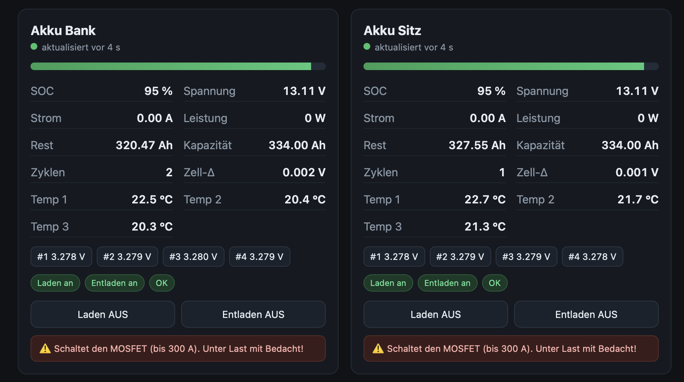

# lithink-ble-monitor

Standalone **ESP32** firmware (Arduino, **no ESPHome**) that reads one or more
**JBD / Jiabaida** LiFePO4 batteries — e.g. **Lithink 12 V 334 Ah** — over
**Bluetooth LE** and serves a small **web UI + JSON API** over WiFi.

- The battery-reading core ([`jbd_bms.h`](jbd_bms.h)) is framework-free C++ and
  is meant to be **lifted into another product** (another firmware or controller).
- The display device (phone/laptop) only needs a browser — **no BLE on the
  client side**. The ESP32 is the BLE reader.



---

## What you get

- Reads **voltage, current, power, SOC, remaining/nominal capacity, cycles**
- **Per-cell voltages** + min / max / delta, **temperatures**, balancing
- **Protection flags**, charge/discharge MOSFET status
- Multiple batteries on one ESP32 (each its own BLE connection)
- Web UI at `http://<hostname>.local` and a JSON API at `/api/data`
- Optional **charge/discharge control** (off by default)
- Optional **wireless firmware updates** (ArduinoOTA) as a separable module

### Optional modules

Two features are isolated so an integrator who only needs the battery reader —
not the UI or the updater — can drop them:

| Module | File | Flag | Default |
|--------|------|------|---------|
| Web UI + JSON API | `web_page.h` + handlers in the `.ino` | — | on |
| Network updates (OTA) | [`ota.h`](ota.h) | `ENABLE_OTA` | on |
| Charge/discharge control | in `jbd_bms.h` / web UI | `ENABLE_CONTROL` | off |
| Truma iNet X heater panel | [`truma_ble.h`](truma_ble.h) + [`truma_core.*`](truma_core.h) | `ENABLE_TRUMA` | off |

The reusable core — [`jbd_bms.h`](jbd_bms.h) — has none of these and depends only
on NimBLE.

---

## Requirements

- Any classic **ESP32** board (`esp32dev`)
- **ESP32 Arduino core 2.0.x** (IDF 4.4) — PlatformIO pins `espressif32 @ 6.9.0`
- **NimBLE-Arduino 1.4.x** library  (1.4.x needs core 2.x — verified booting on real hardware)
- The ESP32 must be **physically close to the batteries** (BLE range, metal
  enclosures attenuate a lot) **and** on a WiFi it can reach reliably.

---

## Build & flash

### Config first
```bash
cp config.example.h config.h      # then edit config.h
```
Fill in your WiFi SSID/password and the battery MAC addresses. `config.h` is
git-ignored so your WiFi password never lands in the repo. Find the MACs with a
BLE scanner (nRF Connect) or from the serial log on first boot.

### Arduino IDE
1. Install **ESP32 board support** — use a **2.0.x** release (Boards Manager →
   “esp32” → pick 2.0.17). NimBLE-Arduino 1.4.x aborts at boot on the 3.x core.
2. Library Manager → install **NimBLE-Arduino** (use a **1.4.x** release).
3. Tools → **Partition Scheme** → **“Minimal SPIFFS (1.9MB APP with OTA)”**
   (needed for the OTA module and to fit the BLE + WiFi stack).
4. Open this folder as a sketch, select your ESP32 board, **Upload** (USB).

### PlatformIO
```bash
pio run -t upload        # NimBLE + partition scheme pinned in platformio.ini
pio device monitor
```

Open `http://lithink-bridge.local` (or the IP from the serial log) on a device
on the **same** WiFi.

### Wireless updates (OTA)

The **first** flash must be over **USB**. After that, with `ENABLE_OTA = 1`,
there are two wireless paths:

**1. Web upload (recommended)** — a browser/`curl` POST to `/update`. This goes
in the same direction as the web UI (client → ESP), so it works even across
**routed / Tailscale / firewalled** networks:

```bash
curl -u admin:<OTA_PASSWORD> -F "fw=@.pio/build/esp32dev/firmware.bin" http://<host>/update
# or open http://<host>/update in a browser
```

**2. ArduinoOTA (espota)** — only on the **same L2 network** as the device, and
it needs the host reachable *from* the ESP (reverse connection), so it fails on
Tailscale/routed setups and when the host firewall blocks the inbound port:

```bash
pio run -t upload --upload-port lithink-bridge.local --upload-flags --auth=<OTA_PASSWORD>
# Arduino IDE: Tools -> Port -> network port "lithink-bridge"
```

> Moving off an existing ESPHome install: ESPHome's OTA can't push this Arduino
> firmware, so do the **one** switch-over flash via USB. From then on it's
> wireless (web upload is the robust option).

---

## JSON API

`GET /api/data` → build flags and one object per battery:

```json
{ "control":0, "truma":1, "batteries": [ {
  "name":"Akku Bank","connected":true,"valid":true,"age_s":3,
  "voltage":13.29,"current":0.00,"power":0,"soc":99,
  "remaining_ah":331.30,"nominal_ah":334.00,"cycles":1,
  "cell_count":4,"cell_delta":0.002,"cells":[3.323,3.324,3.325,3.323],
  "temps":[22.4,20.6],
  "charging_fet":true,"discharging_fet":true,"balancing":false,"protection":0
} ] }
```

`POST /api/control?bat=<i>&what=charge|discharge&on=0|1` — only active when built
with `ENABLE_CONTROL = 1`.

`GET /api/status` → diagnostics: `uptime_s`, `reset_reason`, `free_heap`,
`min_free_heap`, `max_alloc_heap` (largest free block), `wifi_rssi`,
`wifi_drops` and the last WiFi outages (`wifi_outages`: time, reason, duration).

With `ENABLE_TRUMA = 1` (see below):

- `GET /api/truma` → panel status, heater values (`null` while unknown), the
  devices on the panel bus, the timers and the display state
- `POST /api/truma?what=<action>&value=<n>` with `what` one of

  | action | value | bus parameter |
  |---|---|---|
  | `mode` | 0 off, 3 heat, 5 fan | `RoomClimate.Mode` |
  | `target` | °C, 5–30 | set point of the running mode |
  | `heat_mode` | 0 fast, 1 comfort | `AirHeating.Mode` |
  | `fan` | 0–10 | `AirCirculation.FanLevel` |
  | `water` | 0/1 | `WaterHeating.Active` |
  | `water_mode` | 0 eco, 1 comfort, 2 hot | `WaterHeating.Mode` |
  | `boost` | 0/1 | `WaterHeating.FasterHeatingMode` |
  | `diesel` | 0/1 | `EnergySrc.DieselLevel` |
  | `electric` | 0 off, 1 = 900 W, 2 = 1800 W | `EnergySrc.ElectricLevel` |
  | `timer` | 0/1, plus `&n=1..6` | `TimerConfig.Timer<n>State` |
  | `pwr_mode` | 1 standby, 3 on | `PowerMgmt.PwrMode` (panel) |
  | `brightness` | 10–100 % | `Panel.Intst` |
  | `dark_brightness` | 0–100 % | `Panel.DarkIntst` |
  | `display_timeout` | 10–600 s | `Panel.DisplayTimeout` |
  | `restore` | 0/1 | restore after a panel reset (stored on the ESP) |
  | `error_reset` | – | `ErrorReset.Req` |
  | `pair`, `unpair`, `reconnect` | – | – |

- `GET /api/truma/log` → the last log lines of the Truma module (plain text)
- `GET /api/truma/bus` → every value the session knows, one
  `<device> <Topic>.<Param> = <value>` per line (diagnostics)

---

## Truma iNet X panel (optional, experimental)

With `ENABLE_TRUMA = 1` the same ESP32 also connects to a **Truma iNet X**
panel over BLE — the way the Truma app does — and adds a heater card to the
web UI:

- room / target temperature (slider), mode off / heat / fan, fan level,
  heating mode fast / comfort
- hot water off / eco / comfort / hot and boost (boost needs heating on and
  switches heating off while it runs)
- energy source diesel on/off and electric off / 900 W / 1800 W (the heater
  keeps at least one source on by itself)
- 230 V status, errors of heater and panel (readable; *reset* only for
  resettable ones), timers on/off
- devices on the panel bus with firmware and serial number
- panel display: on / standby, brightness, dimmed brightness, dim timeout,
  "last used"
- values greyed out with their age while the panel is not connected
- optional **restore after a panel reset**: the main switch resets the heater
  to factory settings (off, 18 °C, electric 1800 W). The ESP remembers the
  settings and writes them back when the panel returns in exactly that
  factory state; settings changed at the panel meanwhile are kept.

- Protocol core: [`truma_core.h`](truma_core.h) / [`truma_core.cpp`](truma_core.cpp),
  vendored unchanged from
  [Moormerlander/esphome-truma-inetx](https://github.com/Moormerlander/esphome-truma-inetx)
  v0.7.6 (host tests in [`tests/`](tests/)).
- BLE glue for NimBLE: [`truma_ble.h`](truma_ble.h), a port of that project's
  ESPHome/Bluedroid glue. Runs in its own task; needs a third BLE connection
  next to two batteries (the NimBLE default of 3 connections is exactly enough).

**Pairing:** press *Koppeln* in the web UI, then choose *add device* on the
panel within 120 s. The panel may show "something went wrong" afterwards —
that refers to the app-level handshake and can be ignored.

**Panel quirks to know:**

- Only one app connection: while the ESP is connected, the Truma app can't be.
- After a lost connection the panel can refuse new ones until it is
  power-cycled. The firmware therefore never drops a working link on purpose;
  session problems are fixed by restarting the session over the same link.
- The panel rotates its BLE address; the bond is found again via its identity
  key (IRK), with the panel name as a fallback.
- `PowerMgmt.PwrMode` = 1 puts only the panel into standby (display dark, or
  dimmed while the heater runs; heater, BLE link and writes keep working);
  3 wakes it to the lock screen. 0 is a real shutdown — heater off, BLE gone,
  only switchable on at the panel — so the firmware does not accept it.
- `Panel.Screensaver` is a state (1 = display dimmed right now), not a
  setting. `Panel.UserInactiveSince` only resets on real use; taps on the
  lock screen don't count. The lock state itself is not on the bus.
- A lost LIN line shows up as heater error `{"sev":1,"code":255,"resettable":0}`
  (panel mode goes to off) and clears by itself when the line is back.
- Some writes are silently ignored by the panel, e.g. overwriting a timer slot.
  Timers deleted in the Truma app disappear on the panel but are still
  reported on the bus.

**Status:** verified on hardware with a Combi D 6 E GEN2 (heater firmware
2.3.0, panel 3.5.38): pairing, reading and writing all values above, and
reconnecting by itself after a panel power cycle, the main switch, ESP
reboots and firmware updates. Overnight run next to two batteries without
WiFi drops; the link was lost once after 7 h 39 min and came back within 33 s.
After the very first flash following pairing the panel needed one power cycle.

**Memory:** the BLE session takes most of the heap; the largest free block is
about 20–30 KB while connected. Large responses are therefore sent without
copies, and the bus dump is only built when enough memory is free. On a crash
the ESP-IDF writes a core dump to the `coredump` partition; read it over USB
with `esptool.py read_flash 0x3F0000 0x10000 core.bin` and open it with
`xtensa-esp32-elf-gdb` and the matching `firmware.elf`.

Host tests (needs OpenSSL for AES):

```bash
cd tests && g++ -std=c++17 -I.. test_core.cpp ../truma_core.cpp -lcrypto -o test_core && ./test_core
```

---

## JBD BLE protocol (reference for integration)

GATT layout (standard JBD / “xiaoxiang”):

| | UUID | direction |
|---|---|---|
| Service | `0xFF00` | |
| Notify  | `0xFF01` | BMS → host (data frames) |
| Write   | `0xFF02` | host → BMS (commands) |

**Framing**
```
Request  : DD A5 <reg> 00 <crc_hi> <crc_lo> 77
Response : DD <func> <status> <len> <data..> <crc_hi> <crc_lo> 77
Checksum : 16-bit, 0x0000 - sum(bytes from <status/reg> through end of <data>)
```
Read basic info → `DD A5 03 00 FF FD 77`  ·  read cells → `DD A5 04 00 FF FC 77`.
Responses can span several BLE notifications — reassemble until the announced
length (`4 + len + 3`) is complete, then verify trailing `0x77`, CRC and
`status == 0`.

**Basic info (func `0x03`)** — byte offsets into `<data>`:

| off | field | type | scale |
|----|-------|------|-------|
| 0  | total voltage | u16 BE | ×0.01 V |
| 2  | current | i16 BE | ×scale A (signed) |
| 4  | remaining capacity | u16 BE | ×scale Ah |
| 6  | nominal capacity | u16 BE | ×scale Ah |
| 8  | cycles | u16 BE | — |
| 12/14 | balance bitmask | u16+u16 | cells 1–16 / 17–32 |
| 16 | protection bitmask | u16 BE | 0 = OK |
| 19 | SOC | u8 | % |
| 20 | FET status | u8 | bit0 charge, bit1 discharge; **bit7 = capacity/current scale** (set → 0.1, else 0.01) |
| 21 | cell count | u8 | — |
| 22 | temp-sensor count | u8 | — |
| 23+ | temperatures | u16 BE each | (raw − 2731) × 0.1 °C |

**Cell info (func `0x04`)**: `len/2` cells, each `u16 BE × 0.001 V`.

**MOSFET control** (register `0xE1`, write `0x5A`): read the current FET byte
(basic info byte 20), set bit 0 (charge) / bit 1 (discharge), then write the
**inverted** low two bits (`1 = off`). See `changeMosfet_()` in `jbd_bms.h`.

---

## Known limitations

- **Two simultaneous BLE connections on one ESP32 are near the RF limit.**
  Reliable operation needs the ESP close to both batteries and good WiFi
  (shared 2.4 GHz radio). If connections flap, consider **one ESP per battery**.
  With `ENABLE_TRUMA` the panel adds a third connection, plus scanning while
  the panel is not connected.
- WiFi watchdog: after 1 min without WiFi the ESP reconnects, after 5 min it
  restarts.
- Data in the JSON is updated from a background task; a reader may briefly see a
  value mid-refresh. Fine for monitoring, not for safety interlocks.
- Control over a 300 A BMS from a browser is powerful — keep `ENABLE_CONTROL`
  off unless you mean it.

## License

MIT — see [LICENSE](LICENSE) — except the optional Truma module
(`truma_core.h`, `truma_core.cpp`, `truma_ble.h`, `tests/test_core.cpp`), which
is **GPL-3.0** (see [LICENSE-GPL-3.0](LICENSE-GPL-3.0)) because it is derived
from Moormerlander/esphome-truma-inetx. A firmware built with
`ENABLE_TRUMA = 1` is therefore covered by the GPL-3.0 as a whole; with
`ENABLE_TRUMA = 0` none of that code is compiled in.
